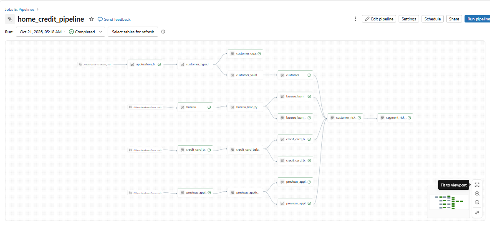
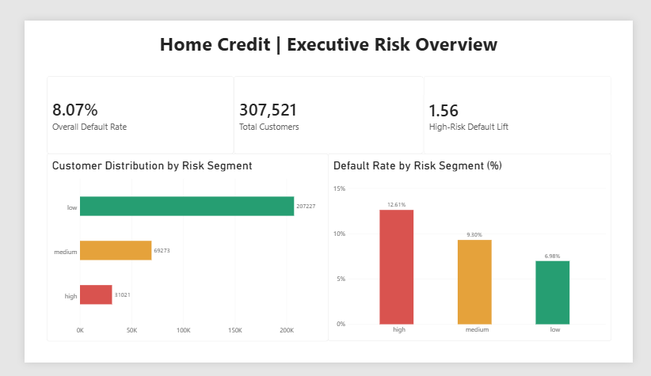
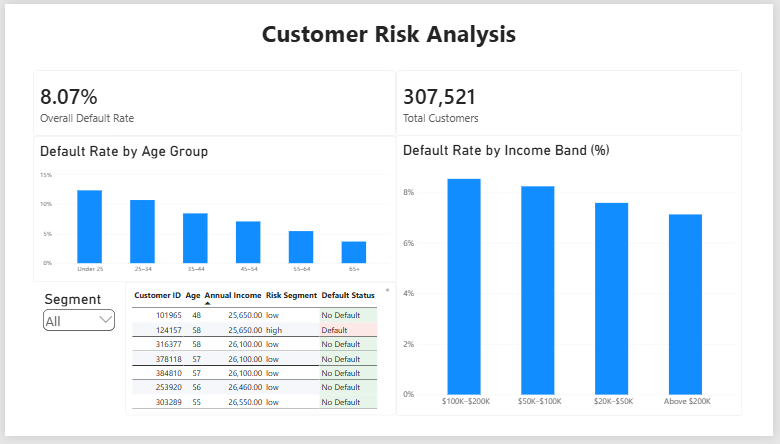

# Home Credit Lakeflow Pipeline

An incremental bronze → silver → gold pipeline on **Databricks (Lakeflow Declarative Pipelines)** that turns four raw lending tables (~7.5M rows) into one trusted, one-row-per-customer risk view.

**Stack:** Databricks Free Edition (serverless), Lakeflow Declarative Pipelines, Auto Loader, Unity Catalog, Delta Lake, PySpark, SQL

## Problem

Risk analysts get raw files where everything is text, placeholder values pose as real data (e.g. `365243` days employed), and keys can repeat across deliveries. This pipeline delivers one clean customer table plus a view of which customer segments default more than average.

## Architecture



```
CSV files (Unity Catalog Volume)
   │  Auto Loader (incremental)
   ▼
BRONZE  raw copy + source file, ingestion time
   │  typed, cleaned, bad rows quarantined, AUTO CDC (SCD type 1)
   ▼
SILVER  customer · bureau_loan · previous_application · credit_card_balance
   │  aggregate to one row per customer, then join
   ▼
GOLD    customer_risk_profile → segment_risk_summary   (materialized views)
```

**Source:** [Home Credit Default Risk](https://www.kaggle.com/competitions/home-credit-default-risk) (Kaggle), 7,534,465 rows across 4 tables.

## Key design decisions

- **Bronze stays raw:** all columns as strings, nothing lost or silently changed.
- **Config-driven:** one factory function builds the bronze tables, and schema names come from pipeline parameters.
- **Explicit type contract in silver:** a column with no type rule fails the build, so nothing enters silver untyped.
- **Quarantine vs. warn-only:** rows with unusable keys are quarantined; odd-but-usable data is counted and kept.
- **AUTO CDC (SCD type 1):** one row per business key, latest version wins.
- **Aggregate before joining:** child tables are reduced to one row per customer first, so joins never multiply rows.

## Results

**Data quality:** every source row reaches silver, all quarantine tables are empty, and the main issues found were handled and counted:

| Finding | Rows | Handling |
|---|---|---|
| Placeholder `365243` employment days (pensioners and unemployed) | 55,374 | Set to null, `is_employed` flag |
| Active loans with an actual end date | 1,968 | Kept, flagged |
| Impossible loan end dates | 184 | Set to null, flagged |

**Performance (Free Edition, serverless):**

| Run | Duration |
|---|---|
| Full refresh, 14 tables | 4m 32s |
| Incremental run after one new file | 2m 9s |

**Incremental + SCD1 test:** a new 100-row file (50 updates, 10 inserts) was ingested by reading only those 100 rows. Updates were applied in place with 0 duplicate keys, and the other three source tables read 0 rows.

**Customer risk segments** (segment = number of past application refusals: high 3+, medium 1-2, low 0):

| Segment | Customers | Default rate | Lift vs. overall (8.07%) |
|---|---|---|---|
| Low | 207,227 | 6.98% | 0.87 |
| Medium | 69,273 | 9.30% | 1.15 |
| High | 31,021 | 12.61% | 1.56 |

Customer counts include the 10 new customers from the incremental test.

## Power BI Dashboard

An interactive, two-page Power BI dashboard connected to the Gold-layer risk tables in Databricks.

### Executive Risk Overview



Highlights overall default rate, customer distribution by risk segment, default rates across risk segments, and high-risk default lift.

### Customer Risk Analysis



Explores default rates by age group and income band, with a risk-segment slicer and customer-level detail table.

**Note:** The dashboard uses descriptive risk segmentation based on historical application refusals. It is not a validated predictive credit-risk model.

## Limitations

- Segment cutoffs were chosen and checked on the same data (no holdout), so this is descriptive segmentation, not a predictive model.
- Some customer IDs in the child tables have no matching application record; they are kept in silver and excluded from gold.
- The incremental test covers inserts and updates, not deletes.
- Scale is 7.5M rows on Free Edition; nothing is claimed beyond that.

## How to run

1. Download the four CSVs from Kaggle and upload each into its own folder in a Unity Catalog Volume.
2. Create the schemas (`home_credit_landing`, `_bronze`, `_silver`, `_gold`).
3. Create a pipeline from the files under `pipelines/` and set the schema and landing-path configuration keys.
4. Run it. To test incremental behavior, drop a new CSV into a table's folder and run again.
5. Open `Home_Credit_Risk_Dashboard.pbix` in Power BI Desktop and sign in to Databricks.
6. Select Home → Refresh to load the latest data from the Gold tables.
